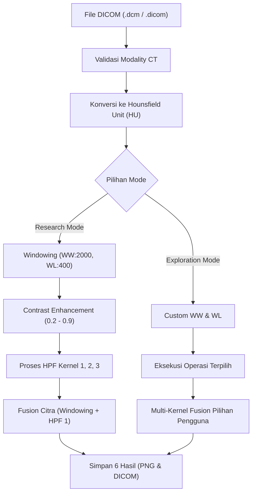

# 🏥 MastoidLab Backend API — CT Mastoid Image Enhancement

Backend RESTful API berbasis **Python** dan **Flask** untuk pengolahan citra medis **CT Scan Tulang Mastoid (DICOM)**. Sistem ini mengimplementasikan algoritma peningkatan kualitas citra (*image enhancement*) yang dirancang khusus untuk memperjelas batas struktur anatomi telinga tengah dan tulang mastoid melalui konversi Hounsfield Unit (HU), Bone Windowing, Contrast Enhancement, High Pass Filtering (HPF) multi-kernel, dan Image Fusion.

---

## 📋 Daftar Isi
1. [Arsitektur & Struktur Direktori](#-arsitektur--struktur-direktori)
2. [Spesifikasi Algoritma Medis](#-spesifikasi-algoritma-medis)
3. [Alur Pipeline & Mode Pemrosesan](#-alur-pipeline--mode-pemrosesan)
4. [Prasyarat & Dependensi](#-prasyarat--dependensi)
5. [Panduan Instalasi & Menjalankan](#-panduan-instalasi--menjalankan)
6. [Konfigurasi Environment (.env)](#-konfigurasi-environment-env)
7. [Dokumentasi API Endpoints](#-dokumentasi-api-endpoints)
8. [Pengujian Mandiri (Unit Testing)](#-pengujian-mandiri-unit-testing)

---

## 📂 Arsitektur & Struktur Direktori

```text
backend/
├── app.py                      # Entry point Flask server, konfigurasi CORS & error handling
├── requirements.txt            # Daftar pustaka dependensi Python
├── .env                        # Konfigurasi variabel lingkungan (Host, Port, Origins, dll.)
├── routes/
│   ├── health.py               # Endpoint pemeriksaan status backend (/health)
│   └── upload.py               # Endpoint pemrosesan DICOM, preview PNG, & unduhan hasil
├── services/
│   ├── dicom_service.py        # Layanan inti DICOM, HU, windowing, contrast, HPF, & fusion
│   ├── enhancement_service.py  # Pipeline logika pemrosesan: Mode Penelitian & Mode Eksplorasi
│   └── output_service.py       # Penyimpanan hasil: Ekspor PNG 8-bit & DICOM Secondary Capture
├── uploads/                    # Direktori penyimpanan sementara file upload (.gitkeep aktif)
├── results/                    # Direktori penyimpanan hasil proses per job_id (PNG & DCM)
└── test_*.py                   # Rangkaian unit test modular per tahapan algoritma
```

---

## 🔬 Spesifikasi Algoritma Medis

Sistem ini mereplikasi dan menyempurnakan kalkulasi matematis standar pengolahan citra medis tulang mastoid:

### 1. Validasi DICOM & Ekstraksi Metadata
- Memvalidasi atribut `Modality == "CT"`.
- Mengekstrak dimensi piksel (`Rows`, `Columns`) serta parameter kalibrasi CT scanner (`RescaleSlope` dan `RescaleIntercept`).

### 2. Konversi Hounsfield Unit (HU)
Matriks piksel mentah (*raw pixel array*) dikalibrasi menjadi skala Hounsfield Unit (HU) standar:
$$\text{HU} = (\text{Pixel Value} \times \text{RescaleSlope}) + \text{RescaleIntercept}$$

### 3. Bone Windowing (Mastoid Setting)
Menyesuaikan rentang intensitas tulang mastoid dengan parameter default:
- **Window Width (WW)**: `2000`
- **Window Level (WL / Window Center)**: `400`
- **Batas Nilai**:
  $$\text{Lower Limit} = \text{WL} - \frac{\text{WW}}{2} = 400 - 1000 = -600\text{ HU}$$
  $$\text{Upper Limit} = \text{WL} + \frac{\text{WW}}{2} = 400 + 1000 = 1400\text{ HU}$$
Nilai kemudian di-*clip* dan dinormalisasi ke rentang intensitas `0 - 255 (uint8)`.

### 4. Peningkatan Kontras (*Contrast Enhancement*)
Mengadaptasi prinsip fungsi `imadjust` MATLAB untuk merenggangkan histogram kontras pada rentang intensitas dinamis:
- Input rentang dinamis: `[0.2, 0.9]` (relatif terhadap rentang `0.0 - 1.0`).
- Nilai yang dihasilkan direntangkan kembali ke `0 - 255 (uint8)`.

### 5. High Pass Filter (HPF) Multi-Kernel
Menerapkan konvolusi 2 dimensi (`scipy.signal.convolve2d`) dengan *boundary padding fill* untuk mendeteksi tepi dan detail mikro trabekula tulang:

* **Kernel 1 (Laplacian 8-Arah)**:
  $$\begin{bmatrix} -1 & -1 & -1 \\ -1 & 8 & -1 \\ -1 & -1 & -1 \end{bmatrix}$$
* **Kernel 2 (Laplacian 4-Arah)**:
  $$\begin{bmatrix} 0 & -1 & 0 \\ -1 & 5 & -1 \\ 0 & -1 & 0 \end{bmatrix}$$
* **Kernel 3 (Laplacian Pembobotan Sudut)**:
  $$\begin{bmatrix} 1 & -2 & 1 \\ -2 & 5 & -2 \\ 1 & -2 & 1 \end{bmatrix}$$

### 6. Image Fusion (Peleburan Citra)
Menggabungkan citra hasil *windowing* asli dengan citra hasil penajaman filter HPF menggunakan akumulasi matriks `int32` yang di-*clip* ke rentang `[0, 255]`. Hal ini menghasilkan citra dengan struktur anatomi yang utuh sekaligus tepi tulang yang sangat tegas.

---

## 🔄 Alur Pipeline & Mode Pemrosesan

Aplikasi mendukung dua mode pemrosesan yang dapat dipilih oleh antarmuka frontend:



1. **Mode Penelitian (*Research Mode*)**:
   - Berjalan secara otomatis menghasilkan 6 luaran baku: `original` (windowed), `contrast`, `hpf_1`, `hpf_2`, `hpf_3`, dan `fusion` (windowing + HPF 1).
2. **Mode Eksplorasi (*Exploration Mode*)**:
   - Fleksibel untuk dokter / peneliti: nilai Window Width & Level dapat diubah secara bebas.
   - Operasi yang dijalankan dapat dipilih secara granular (`windowing`, `contrast`, `hpf_1`, `hpf_2`, `hpf_3`, `fusion`).
   - Fusion mendukung penggabungan beberapa kernel sekaligus (contoh: `hpf_1` + `hpf_2`).

---

## 📦 Prasyarat & Dependensi

* **Python**: Versi `3.10` atau lebih baru
* **Daftar Dependensi Utama**:
  * `Flask >= 3.0.0` — Framework REST API
  * `flask-cors >= 4.0.0` — Pengaturan Cross-Origin Resource Sharing
  * `pydicom >= 2.4.0` — Pembacaan dan manipulasi file DICOM
  * `numpy >= 1.24.0` — Operasi matriks dan array numerik
  * `scipy >= 1.10.0` — Operasi konvolusi sinyal 2D citra
  * `matplotlib >= 3.7.0` — Pengujian & visualisasi histogram/plot
  * `Pillow >= 10.0.0` — Konversi dan penyimpanan file citra PNG 8-bit
  * `python-dotenv >= 1.0.0` — Pengelolaan variabel lingkungan lokal

---

## 🚀 Panduan Instalasi & Menjalankan

### 1. Masuk ke Direktori Backend
```powershell
cd "d:\Koding\mbak deva\Image_processing_on_CT_Mastoid_HKI\backend"
```

### 2. Buat dan Aktifkan Virtual Environment
```powershell
python -m venv venv
.\venv\Scripts\Activate.ps1
```
*(Pastikan tanda `(venv)` muncul di baris terminal).*

### 3. Pasang Semua Dependensi
```powershell
pip install -r requirements.txt
```

### 4. Jalankan Server API
```powershell
python app.py
```
Server akan aktif secara lokal di: `http://127.0.0.1:5001`.

---

## ⚙️ Konfigurasi Environment (`.env`)

File `.env` terletak di root folder `backend/`:

```ini
FLASK_HOST=127.0.0.1
FLASK_PORT=5001
FLASK_DEBUG=true
FRONTEND_ORIGIN=http://localhost:3000,http://127.0.0.1:3000
MAX_CONTENT_LENGTH=52428800
```

| Variabel | Deskripsi | Default |
| :--- | :--- | :--- |
| `FLASK_HOST` | Host address untuk bind server | `127.0.0.1` |
| `FLASK_PORT` | Port server Flask berjalan | `5001` |
| `FLASK_DEBUG` | Mengaktifkan debugger otomatis dan auto-reload | `true` |
| `FRONTEND_ORIGIN` | Alamat URL frontend Next.js yang diizinkan CORS | `http://localhost:3000,http://127.0.0.1:3000` |
| `MAX_CONTENT_LENGTH` | Batas maksimal ukuran payload file (byte) | `52428800` (50 MB) |

---

## 📡 Dokumentasi API Endpoints

### 1. Root & Health Check

#### `GET /`
Mengembalikan teks status sederhana untuk verifikasi dasar.
- **Response `200 OK`**:
  ```text
  MastoidLab Image Enhancement API is Running
  ```

#### `GET /health`
Pemeriksaan kesehatan server untuk monitoring sistem.
- **Response `200 OK`**:
  ```json
  {
    "status": "success",
    "application": "Mastoid CT Image Enhancement",
    "message": "Backend is running"
  }
  ```

---

### 2. Unggah & Proses Citra DICOM

#### `POST /upload`
Mengunggah file DICOM, mengeksekusi pipeline enhancement, dan menghasilkan file luaran PNG & DICOM turunan.

* **Content-Type**: `multipart/form-data`
* **Form Parameters**:
  * `file` *(Wajib, File)*: File `.dcm` atau `.dicom`.
  * `mode` *(Opsional, String)*: `"research"` (default) atau `"exploration"`.
  * `window_width` *(Opsional, Number)*: Nilai Window Width (default `2000`).
  * `window_level` *(Opsional, Number)*: Nilai Window Level (default `400`).
  * `operations` *(Opsional, JSON String, Khusus Exploration)*: Contoh `["windowing", "contrast", "hpf_1", "fusion"]`.
  * `fusion_kernels` *(Opsional, JSON String, Khusus Exploration)*: Contoh `["hpf_1", "hpf_2"]`.

* **Contoh Respon Berhasil (`200 OK`)**:
  ```json
  {
    "status": "success",
    "message": "Enhancement citra berhasil dilakukan.",
    "job_id": "4a7f6c3821034d67969019de50ad8593",
    "mode": "research",
    "metadata": {
      "modality": "CT",
      "rows": 512,
      "columns": 512,
      "rescale_slope": 1.0,
      "rescale_intercept": -1024.0,
      "window_width": 2000.0,
      "window_center": 400.0
    },
    "results": {
      "original": {
        "png": "ct_mastoid_original.png",
        "dicom": "ct_mastoid_original.dcm",
        "shape": [512, 512],
        "dtype": "uint8",
        "preview_url": "http://127.0.0.1:5001/preview/4a7f6c.../ct_mastoid_original.png",
        "download_png_url": "http://127.0.0.1:5001/download/4a7f6c.../ct_mastoid_original.png",
        "download_dicom_url": "http://127.0.0.1:5001/download/4a7f6c.../ct_mastoid_original.dcm"
      },
      "contrast": { "...": "..." },
      "hpf_1": { "...": "..." },
      "hpf_2": { "...": "..." },
      "hpf_3": { "...": "..." },
      "fusion": { "...": "..." }
    }
  }
  ```

* **Respon Kesalahan**:
  * `400 Bad Request`: Format file tidak valid, bukan modalitas CT, atau parameter tidak sesuai.
  * `413 Payload Too Large`: Ukuran file melebihi 50 MB (`{"status": "error", "message": "Ukuran file terlalu besar. Maksimal 50 MB."}`).
  * `500 Internal Server Error`: Kesalahan sistem internal pada pemrosesan citra.

---

### 3. Pratinjau & Unduh Hasil

#### `GET /preview/<job_id>/<filename>`
Menampilkan citra hasil format `.png` secara langsung (*inline streaming*) pada elemen `` di browser.

#### `GET /download/<job_id>/<filename>`
Mengunduh file luaran baik format `.png` maupun format `.dcm` sebagai *attachment* unduhan langsung ke komputer klien.

---

## 🧪 Pengujian Mandiri (Unit Testing)

Tersedia skrip pengujian mandiri untuk memverifikasi kebenaran matematis masing-masing komponen:

```powershell
# Uji baca metadata dan konversi DICOM
python test_dicom.py

# Uji fungsi rumus kalibrasi Hounsfield Unit (HU)
python test_hu.py

# Uji kalkulasi algoritma Windowing
python test_windowing.py

# Uji perentangan kontras (Contrast Enhancement)
python test_contrast.py

# Uji konvolusi 2D High Pass Filter
python test_hpf.py

# Uji penggabungan citra (Fusion)
python test_fusion.py

# Uji pipeline terintegrasi keseluruhan
python test_enhancement.py
```

---

## 🔒 Standar Keamanan & Manajemen Penyimpanan

1. **Isolasi Hasil per Job ID**: Setiap proses unggahan memiliki direktori unik berbasis `uuid4().hex` di dalam folder `results/`, mencegah konflik nama file antar pengguna.
2. **Pembersihan File Unggahan**: File asli yang diunggah ke folder `uploads/` langsung dihapus secara aman pada blok `finally` setelah proses konversi selesai.
3. **Penyimpanan DICOM Sekunder**: Hasil DICOM diekspor menggunakan standar `SecondaryCaptureImageStorage` (`Modality: OT`), sehingga tidak merusak atau menimpa dataset radiologi orisinal pasien.
