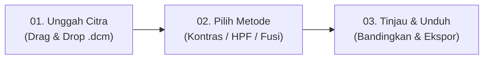

# 🖥️ MastoidLab Frontend — CT Mastoid Image Enhancement

Antarmuka web interaktif berbasis **Next.js (App Router)**, **React 19**, dan **Tailwind CSS v4** untuk aplikasi pengolahan citra medis CT Scan Tulang Mastoid. Antarmuka ini terhubung langsung dengan RESTful API backend Flask untuk melakukan visualisasi, penajaman tepi mikro, fusi citra, dan ekspor hasil DICOM/PNG secara terpadu.

---

## 📋 Daftar Isi
1. [Fitur Utama](#-fitur-utama)
2. [Alur Tiga Langkah Kerja](#-alur-tiga-langkah-kerja)
3. [Struktur Direktori Frontend](#-struktur-direktori-frontend)
4. [Konfigurasi Variabel Lingkungan (.env)](#-konfigurasi-variabel-lingkungan-env)
5. [Panduan Instalasi & Eksekusi](#-panduan-instalasi--eksekusi)
6. [Integrasi dengan Backend API](#-integrasi-dengan-backend-api)
7. [Teknologi yang Digunakan](#-teknologi-yang-digunakan)

---

## ✨ Fitur Utama

- **Live Upload Progress**: Melacak kemajuan unggahan file DICOM berukuran besar secara *real-time* (0–100%) menggunakan `XMLHttpRequest`.
- **Ekstraksi Metadata Otomatis**: Menampilkan informasi teknis DICOM asli langsung dari scanner medis (Resolusi, Dimensi Piksel, Modalitas CT, Window Width, dan Window Level).
- **Pratinjau Citra Nyata**: Merender citra medis hasil konversi Hounsfield Unit (HU) dan bone windowing langsung pada penampil berbasis kanvas/gambar, bukan gambar *mock-up*.
- **Kontrol Zoom & Panning**: Kemampuan memperbesar citra (hingga 250%), memperkecil, dan melakukan *reset zoom* untuk menginspeksi trabekula tulang mastoid.
- **Dua Mode Pemrosesan**:
  1. **Mode Penelitian (Baku)**: Pipeline otomatis sesuai modul penelitian HKI ($WW=2000, WL=400$, Fusi Kernel 1).
  2. **Mode Eksplorasi**: Pengguna dapat menyesuaikan Window Width dan Window Level secara bebas serta memilih pasangan kernel HPF untuk fusi citra.
- **Komparasi Visual *Side-by-Side***: Membandingkan citra CT asli (*bone windowing*) berdampingan dengan citra hasil penajaman (*enhanced*).
- **Interactive Result Selector**: Tombol *tab selector* di layar hasil untuk beralih instan antara luaran `Original`, `Kontras`, `HPF 1`, `HPF 2`, `HPF 3`, dan `Fusi`.
- **Multi-Format Export**: Mengunduh hasil baik dalam format citra visual **PNG (8-bit grayscale)** maupun format medis **DICOM (.dcm)** yang sesuai standar *Secondary Capture*.

---

## 🔄 Alur Tiga Langkah Kerja



1. **Langkah 1 (Unggah Citra)**:
   - Pengguna memasukkan file `.dcm` atau `.dicom` melalui *drag-and-drop* atau *file picker*.
   - Frontend memverifikasi ekstensi dan mengirimkannya ke endpoint `/upload` backend.
2. **Langkah 2 (Pilih Metode & Parameter)**:
   - Menampilkan pratinjau citra asli yang telah di-*windowing* beserta metadata DICOM.
   - Memilih metode (*Peningkatan Kontras*, *HPF Kernel 1/2/3*, atau *Fusi Citra*).
   - Memilih antara *Mode Penelitian* atau *Mode Eksplorasi* (jika ingin mengatur WW/WL khusus).
3. **Langkah 3 (Tinjau Hasil & Unduh)**:
   - Tampilan perbandingan citra sebelum dan sesudah diproses.
   - Mengunduh luaran PNG untuk laporan penelitian atau file DICOM untuk arsip medis.

---

## 📂 Struktur Direktori Frontend

```text
frontend/
├── app/
│   ├── favicon.ico             # Ikon peramban web
│   ├── globals.css             # Konfigurasi Tailwind CSS dan font tema
│   ├── layout.tsx              # Root layout aplikasi Next.js
│   └── page.tsx                # Halaman utama aplikasi (Alur 3 Langkah & State Management)
├── public/                     # Aset statis publik
├── .env                        # Konfigurasi URL Backend (NEXT_PUBLIC_API_URL)
├── .gitignore                  # File pengabaian Git (env, node_modules, .next)
├── next.config.ts              # Konfigurasi Next.js (Turbopack, cache)
├── package.json                # Daftar dependensi modul Node.js
├── tsconfig.json               # Konfigurasi TypeScript
└── README.md                   # Dokumentasi resmi antarmuka frontend
```

---

## ⚙️ Konfigurasi Variabel Lingkungan (`.env`)

Sesuai standar Next.js, variabel yang diakses di sisi klien (*client-side*) menggunakan prefiks `NEXT_PUBLIC_`. Konfigurasi disimpan dalam file `.env` di dalam folder `frontend/`:

```env
# Alamat URL Backend API Flask MastoidLab
NEXT_PUBLIC_API_URL=http://127.0.0.1:5001
```

> [!NOTE]
> File `.env` ini telah terdaftar di `.gitignore` untuk mencegah tereksposnya konfigurasi lokal ke repositori publik.

---

## 🚀 Panduan Instalasi & Eksekusi

### 1. Masuk ke Direktori Frontend
```powershell
cd "d:\Koding\mbak deva\Image_processing_on_CT_Mastoid_HKI\frontend"
```

### 2. Pasang Dependensi Node.js
```powershell
npm install
```

### 3. Jalankan Server Pengembangan (Development Server)
```powershell
npm run dev
```

Buka peramban Anda di [http://localhost:3000](http://localhost:3000).

---

## 🔌 Integrasi dengan Backend API

Frontend berkomunikasi dengan backend Flask melalui endpoint-endpoint berikut:

| Endpoint | Method | Fungsi pada Frontend |
| :--- | :--- | :--- |
| `/upload` | `POST` | Mengunggah file DICOM, mengekstrak metadata, dan memproses algoritma |
| `/preview/<job_id>/<file>` | `GET` | Menampilkan pratinjau citra PNG langsung pada elemen `` |
| `/download/<job_id>/<file>` | `GET` | Mengunduh file hasil (PNG / DCM) sebagai *attachment* |

---

## 🛠️ Teknologi yang Digunakan

- **Framework**: Next.js 16 (App Router)
- **Library Inti**: React 19
- **Bahasa**: TypeScript 5
- **Styling**: Tailwind CSS v4
- **Ikon**: Lucide React
